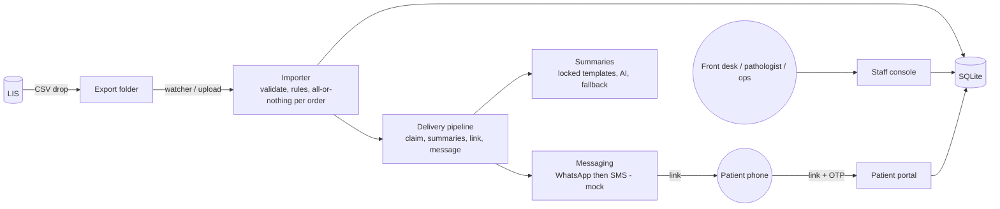
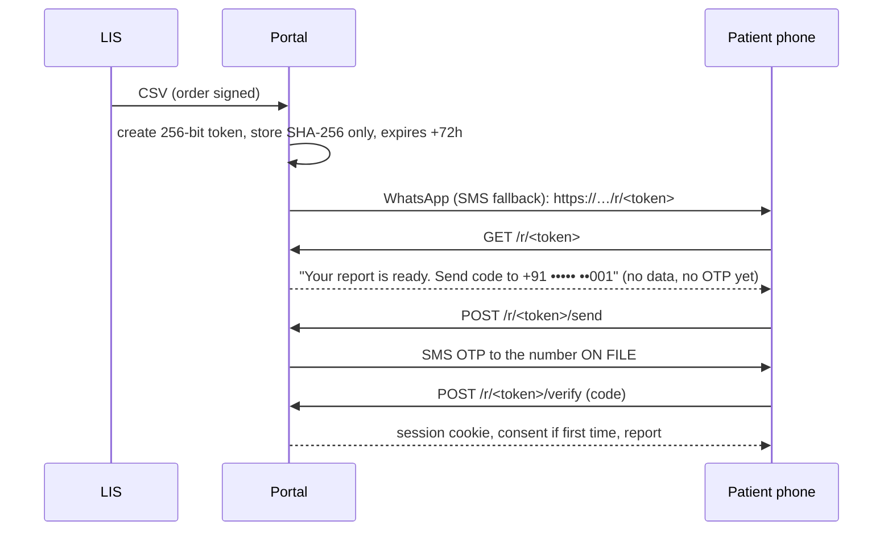

# Technical Design Document: Report-delivery portal

Repository: <https://github.com/rohithkumar2027/ISO-Code-3>
Client: Company A (6 labs, 38 collection centres, Vijayawada). Budget ₹6.5 lakh, 6 weeks.

## 1. Goal and scope

**Goal.** Patients never call to ask about a report. When the pathologist signs, the patient receives a
safe link automatically, opens it with an OTP, and reads a short plain explanation in English, Telugu
or Hindi. Front-desk staff stop sending PDFs by hand from 9 shared phones.

**Core build (shipped, working end to end):** LIS CSV import → automatic link on sign-off → patient OTP
portal with report view → plain-language summary → front-desk resend. Roles: patient, front-desk staff.

**Extra depth shipped:** DPDP consent, access log, critical-value callback tasks, delivery tracking with
WhatsApp→SMS fallback, operations delivery/access report, pathologist review queue, PDF download,
patient "this looks wrong" flag, family numbers.

**Not shipped:** referring-doctor 90-day view; real WhatsApp/SMS gateways; hosting. Out of scope per brief:
LIS changes, test booking/payment, home collection.

**Deliberate choice:** build the core slice well rather than every item thinly. One honest hard part
(links + OTP) gets the most care.

## 2. Assumptions (labelled; the brief gave only three sample rows)

| # | Assumption | Why / effect |
|---|---|---|
| A1 | The LIS CSV has these columns: the seven in the sample **plus** `Mobile`, and optionally `Age`, `Sex`, `Collected At`, `Signed At`. One row per parameter. | The sample has no phone number, yet delivery needs one. Importer rejects files missing a required column. |
| A2 | `Ready` means the pathologist has signed; `Ready (critical)` means signed and the **LIS** flagged a critical value; `Processing` means not signed. We do not invent critical thresholds. | Keeps clinical judgement with the lab. |
| A3 | An order is signed when **all** its rows are Ready. Any `Processing` row keeps the order unsigned; any critical row makes it critical. | Conservative: never release a half-finished report. |
| A4 | The reference range printed in the export is authoritative for flags (`12.0-15.5`, `<5.7`, `>40` forms). Non-numeric results (e.g. "Trace") are shown but never flagged. | Matches "flags come from rules using the report's reference ranges". |
| A5 | Export times are IST. | Brief is for Andhra Pradesh. |
| A6 | The mobile on file is the patient's or family's WhatsApp-capable number; one number can cover several patients. After OTP the holder sees all reports on that number. | Brief: "One number often covers a whole family". Sharing a number is treated as family consent. |
| A7 | The LIS may export `Processing` rows with provisional values. We store them but **never show** them. | Avoids showing unsigned results. |
| A8 | The LIS signed PDF is not available to us, so the PDF is a stand-in generated from the export (Latin text only). In production the LIS PDF dropped beside the CSV would be served instead. | Needed to demonstrate download end to end. |
| A9 | OTPs go by SMS to the number on file; report links go by WhatsApp first, SMS second. Template approval for WhatsApp Business is handled outside this build. | Mocked as the brief allows. |
| A10 | Link lifetime is 72 h from the moment the link is **created** (sign-off or resend), not from sign-off. | A resend gives a fresh 72 h. |
| A11 | Roles: patient, `frontdesk`, `pathologist`, `ops`. | Brief names patient and front desk; the review and report needs imply the other two. |
| A12 | The weekly 50-summary review is drawn from locked-template summaries created in the last 7 days; AI-written and patient-flagged ones are always queued. | The brief says "50 a week" but not how to pick them. |
| A13 | Message and consent wording is placeholder text pending legal review; Telugu/Hindi wording needs native-speaker and pathologist sign-off. | See Limits. |
| A14 | One report may carry several patients on one number, and names are matched on a lower-cased, punctuation-free key within a mobile. | Needed to group a family. |

## 3. Architecture

Deliberately small: one Node.js process, server-rendered HTML, SQLite. **No JavaScript is sent to the
browser** and pages are a few KB, because patients use low-end phones on weak data.

**Stack choice.** Node 22 + Express, `node:sqlite`, `pdfkit`, `multer` (upload). Four dependencies; no
front-end build. Server-side templates use an auto-escaping `html` tagged template (all interpolations are
escaped unless explicitly marked raw), which removes a whole class of XSS mistakes.

**Production path.** Swap SQLite for PostgreSQL in an Indian region (same SQL, small port), put TLS and
gzip at a reverse proxy, run two app instances behind it. See Limits.

## 4. Data model (`src/schema.sql`)

`patients (mobile, name)` → `orders` → `results` (value, range, **flag computed on import**) ·
`report_links` (token **hash**, expiry, revoked, opens) · `otps` (HMAC of code, attempts, expiry) ·
`sessions` (hash of cookie id, CSRF token) · `messages` (channel, status, error; **no body, no token**) ·
`tasks` (critical callbacks) · `summaries` (text per language, source, status) · `summary_flags` ·
`import_runs` · `accounts` (language, consent version and time) · `staff_users` · `access_log`.

A `UNIQUE (mobile, name_key)` constraint lets one number hold several patients. `orders.delivered_at` is
claimed with a single conditional `UPDATE`, which makes automatic delivery safe against double runs.

## 5. The hard part: secure expiring links with OTP

### Flow

### Decisions and the threats they answer

| Threat | Control |
|---|---|
| Link forwarded or sent to the wrong number (about 15 reports a month today) | The link alone never shows data. OTP goes to the number **on file**, never to a number the visitor types. Wrong person has the link but not the phone. |
| WhatsApp / antivirus link previews fetch the URL | `GET` only renders a landing page; **no OTP is sent and nothing is consumed** until the visitor presses the button. |
| Database leak | Tokens are stored as SHA-256, OTPs as HMAC(secret, mobile, purpose, link, code), session ids as SHA-256. Messages store status only. A leaked table opens nothing. |
| Guessing | 256-bit tokens; malformed tokens are rejected before any database lookup. |
| OTP brute force | 6 digits, 5 attempts then locked (attempt counted **before** comparing), 5-minute life, single use, a new OTP voids the old, 30 s cooldown and 5 sends/hour per number, plus per-IP limits. |
| OTP reuse across links or purposes | The HMAC binds the code to mobile, purpose and link id. |
| Account enumeration | An unknown number and a known number get the same response and timing shape; no OTP is sent to unknown numbers. |
| Old link after resend | Creating a link revokes earlier links for that order. |
| Expiry | 72 h; expired and revoked links show a safe page offering normal mobile+OTP login (which "reopens" the report). |
| Token leaking via Referer | `Referrer-Policy: same-origin`, no third-party resources at all, and the page has no external links. |
| Session theft / idle devices | Server-side sessions, `HttpOnly; SameSite=Lax; Secure` (when HTTPS) cookie, 20 min idle and 2 h absolute for patients. |
| IDOR on reports | Every report/PDF lookup joins on the session's mobile; another patient's order returns **404**, not 403. |
| Unsigned data exposure | Order status is checked on every request; Processing orders return a "not ready" page and no results. |

## 6. LIS import (`src/services/importer.js`)

- Watches `LIS_EXPORT_DIR` every 5 s; files are imported, then moved to `processed/` (or `failed/` with a
  `.error.txt`). Staff can also upload a CSV (2 MB limit, `.csv` only).
- RFC 4180 parser (quotes, BOM, CRLF); a truncated quote fails the whole file instead of half-importing.
- Each order is validated and applied **all-or-nothing in one transaction**. A bad row rejects only its
  order and the reason is reported with line number.
- **Idempotent**: re-importing a file changes nothing. A signed order is never silently changed by a
  later export (amendments are reported and require manual handling).
- Corrections to a `Processing` order are accepted; the transition to Ready triggers delivery once.
- After import a sweep delivers every signed order not yet delivered, so a crash between import and send
  is repaired on the next tick.

## 7. Plain-language summaries and what happens when the AI is wrong

**Flags are rules, not AI.** `rules.js` parses the printed reference range and sets low/normal/high.

| Situation | Behaviour |
|---|---|
| Critical order (LIS flag) | **No summary at all.** Patient sees an urgent banner and the numbers; a callback task is created for staff. |
| Test is one of 30 locked templates (Hb, WBC, platelets, RBC, PCV, MCV, fasting and post-meal sugar, HbA1c, total/LDL/HDL cholesterol, triglycerides, creatinine, urea, uric acid, sodium, potassium, calcium, SGOT, SGPT, ALP, bilirubin, TSH, T4, vitamin D, B12, ferritin, ESR, CRP) | Fixed reviewed text in en/te/hi. **No AI is called.** Matching is exact on aliases, so "Lipoprotein (a)" can never be mistaken for a cholesterol test. |
| Any other out-of-range test and an AI key is configured | The AI gets only the test name, the direction (lower/higher) and the language: **no patient identity, no values**. The answer is validated (JSON, length, no digits, no links or markup, banned diagnostic/treatment wording, must refer the patient to a doctor, correct script for Telugu/Hindi). |
| AI is off, errors, times out (8 s) or fails validation | Generic safe sentence. The report never blocks on the AI. |
| Non-numeric result or unreadable range | Not flagged; shown as "See report". |
| AI-written text | Labelled "Written by AI. Not yet checked by a pathologist." until approved; queued for review. |
| A patient taps "This explanation looks wrong" | The summary is **hidden in all three languages** for everyone until a pathologist approves it (shown with a "checked" mark) or rejects it (replaced by the generic sentence). |
| Weekly quality check | Review page shows flagged items, AI items, and a stable weekly random sample of 50 locked-template summaries. Reviewers see wording and value, **not patient identity**. |
| Always | Every summary page links to the full report and states it is not a diagnosis. |

Honest note: the AI path is implemented against the Anthropic Messages API but this build was tested with
stubbed responses only (no API key in the repository). With no key the locked templates and the safe
fallback carry everything, and the tests show that.

## 8. DPDP Act 2023 mapping

| Requirement | How |
|---|---|
| Consent at registration | First login shows a plain-language notice (in the patient's language) before any report; consent version and time stored; decline logs the patient out. |
| Purpose and minimisation | Messages carry the order id only: no name, no values. The AI sees no identity. Staff reviewers see no identity. |
| Access log | `access_log` records patient logins, OTP failures, link opens, report views, PDF downloads, consent, staff searches, patient-page views, resends, imports. Patient numbers are masked in the log. Staff can filter it by order. |
| Hosting in India | Not deployed in this build. Design target: an Indian region (e.g. Mumbai/Hyderabad) for app, database and backups. The AI call is the one external dependency; send only non-identifying text or use an India-hosted model endpoint. |
| Withdrawal | `accounts.withdrawn_at` is honoured by the consent gate; a self-service withdraw button is future work. |
| Retention and erasure | Not implemented (policy decision for the client). |

## 9. Design and UX decisions

- One clear action per screen, 18 px base text, 56 px controls, a single restrained teal accent.
- Status is never colour alone: "✓ Ready", "… Being prepared", "▼ Low", "▲ High", "! Needs attention".
- The report page leads with "What stands out": test name, large value, usual range, a small SVG range bar,
  then the explanation. Normal values stay out of the way in "All results".
- Telugu/Hindi: `lang` attributes, taller line height, system Noto/Nirmala fonts (no web-font download),
  local-language test names under the English names. Language chips are on every page; the choice is remembered.
- Loading, empty and error states exist on every list and form (no match, no reports yet, bad file, expired
  link, locked OTP).
- Weight: login page 1.3 KB; report page ≈ 5–6 KB (≈ 2 KB gzipped); one 10 KB stylesheet (3 KB gzipped);
  zero JavaScript. Staff screens are denser but use the same stylesheet.

## 10. Security checklist

Auto-escaped templates; parameterised SQL everywhere (LIKE inputs escaped); strict CSP (`default-src 'none'`,
no inline script or style); `nosniff`, `X-Frame-Options`, `no-store` on all dynamic pages, HSTS in production;
CSRF: `SameSite=Lax`, Fetch-Metadata and Origin checks on every POST, per-session tokens on authenticated forms;
scrypt for staff passwords with a dummy hash to equalise timing; failed-login lockout; role checks on every staff
route; upload limits (size, type, count); no secrets in the repo (`.env` ignored; `APP_SECRET` mandatory in
production; demo passwords are random per run and printed, never stored; `DEMO_MODE` refused in production);
errors never expose stack traces; `npm audit` clean.

## 11. Testing

82 tests (`npm test`), no network. Important logic is covered at two levels:

- **Unit:** range/flag rules, CSV parsing, importer edge cases (idempotency, partial orders, signed-order
  protection), OTP (expiry, lockout, single use, binding), links (hashing, expiry, revoke), sessions,
  summaries (30 templates × 3 languages, AI validation, fallbacks, critical rule, flag/review), delivery
  (single send, concurrency, critical task, SMS fallback, total failure, resend).
- **HTTP end to end:** login and consent, link flow, IDOR attempts, expired links, session expiry, CSRF and
  headers, secrets-not-in-database checks, every staff page's role gate, search injection, import upload
  limits, callbacks, access log, ops numbers, pathologist review.

Visual and mobile checks were done by hand in a 375 px browser (login, consent, list, report in Telugu).

## 12. Success metrics and how the product measures them

| Brief | Measure |
|---|---|
| Status calls down 60% | Count of calls is outside the system; the portal removes the reason to call (status always visible, link on sign-off). Baseline needed from the client. |
| 80% delivered digitally | Delivery report: signed vs delivered (sent or delivered receipt) with the 80% target shown. |
| Printing halved | Follows from digital delivery; the same report shows undelivered reports staff must handle. |
| No report opened by the wrong person | OTP to the number on file on every open; access log; wrong-OTP and expired-link counts on the report. |

## 13. Limits (what an honest reviewer should know)

1. WhatsApp, SMS and OTP delivery are **mocked**. Real gateways need approved templates and DLT registration.
2. The PDF is generated from the export (Latin only). The LIS-signed PDF should replace it.
3. Telugu and Hindi texts are first-draft translations by the developer; they need native-speaker and
   pathologist review before launch.
4. The AI path has not been exercised against the live API here (tested with stubs).
5. Single-node SQLite (`node:sqlite` is still flagged experimental in Node 22). OTP/login rate limiters are
   per-process memory; use a shared store with multiple instances.
6. Referring-doctor view and self-service consent withdrawal are not built.
7. No retention/erasure policy, no deployment, no gzip/TLS (reverse proxy duties), no formal accessibility audit
   with a screen reader.
8. A shared family number means anyone with the phone sees every family member's reports. This follows the
   client's reality but is a privacy trade-off to confirm with legal.
9. A signed report that is amended in the LIS is flagged and not applied automatically.
10. Critical reports still send the link (patients are not made to wait for a call); the report shows an urgent
    banner without explanation and a callback task is raised. The alternative (hold the link until the callback
    is done) is a one-line policy change in `delivery.js`: the client should choose.

## 14. If this went to production (6 weeks, ₹6.5 lakh)

Weeks 1–2: real WhatsApp/SMS and DLT, LIS folder integration on a test export, PostgreSQL in an Indian region.
Weeks 3–4: doctor view, native-speaker and pathologist review of wording, withdraw-consent and erasure.
Weeks 5–6: pilot at two centres, accessibility test with elderly users, load test, runbook, go-live.
